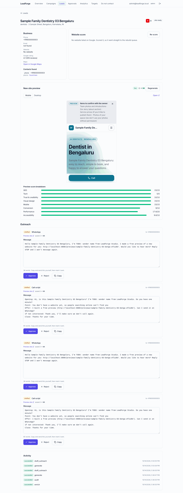
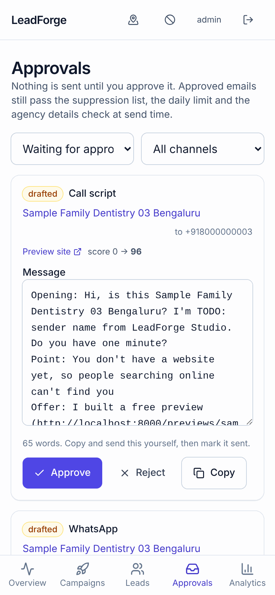

# LeadForge

LeadForge finds local businesses in Tier-1 Indian and US cities through the official
Google Places API, scores their websites, builds better mobile-first replacements for
the weak ones, and drafts a proposal email for a human to approve. Nothing is ever sent
without a person clicking **Approve & send**.

## Status

All eight phases are built and run end to end on mocked APIs. No paid API has been
called and no email has been sent; going live is a checklist in
[docs/runbook.md](docs/runbook.md#going-live-each-step-costs-money-or-reaches-real-people-do-them-deliberately).

| Phase | Scope | State |
| --- | --- | --- |
| 1 | Foundation: monorepo, docker-compose, schema, auth, CI | Done |
| 2 | Discovery (Places API New) + enrichment (crawl, emails, phones, dedup) | Done |
| 3 | Scoring engine (rubric v1.0.0, PageSpeed, Playwright + axe, vision review) | Done |
| 4 | Dashboard: campaigns, leads, exports, lead detail, approvals, analytics | Done |
| 5 | Animated Next.js template library (8 looks, 3D heroes) | Done |
| 6 | Generator + preview deploy + quality gate (≥ 90 and +30) | Done |
| 7 | Outreach: drafts, approvals, sending, follow-ups, unsubscribe | Done |
| 8 | Hardening: request IDs, security headers, metrics, cost caps, docs | Done |

### How a lead moves through it

1. **Discover**: a campaign runs one Places Text Search per city × category (field
   masks, up to 60 results), upserts by `place_id` and folds duplicate listings together.
2. **Enrich**: the crawler reads the homepage and up to 10 contact/about pages,
   honouring robots.txt and crawl-delay with a clear User-Agent. It keeps only publicly
   published emails, phones, WhatsApp and social links, each with the page it came from,
   and checks MX records. Nothing is guessed; missing values say "not found". It also
   lists every public page of the current site (links plus sitemap.xml, robots.txt
   respected, up to 30 pages), keeping only each page's path, nav label and kind.
3. **Audit**: every site gets a 0 to 100 score with a per-category breakdown, top issues
   in plain English and screenshots ([docs/scoring.md](docs/scoring.md)).
4. **Generate**: sites under 60 (and businesses with no site) get a site spec, copy that
   uses only facts from Places and the business's own pages (placeholders where facts are
   missing), a palette from their brand colours, and an animated Next.js build deployed
   as a `noindex` preview. **Every page of the current site gets a page on the new one**
   at the same address (old `.html`/`.php` addresses redirect to the clean URL). Page
   copy is rewritten from known facts, never copied; menus, bios, prices and blog posts
   are clearly marked placeholders for the owner to supply.
5. **Gate**: the preview is audited with the same rubric. It goes live only at ≥ 90,
   at least +30 over the original, and with every original page answering on the
   preview; otherwise it retries with fixes and then goes to manual review with the
   missing pages listed.
6. **Draft**: two short email variants (or a WhatsApp message and call script when no
   email is published), with the before/after score, postal address and one-click
   unsubscribe. A human approves each one.

### Demo results (mocked APIs)

`make demo` on Bengaluru + Austin dentists creates 60 leads (plus 2 duplicate listings
folded in). Every lead under 60 gets a live preview scoring at least 90, and the outreach
drafts wait for approval, and every page of each original site (up to 10 on the
multi-page fixtures) answers on its preview. The same run is the acceptance test in
`api/tests/test_pipeline.py`. With the Next.js builder, previews score 96 against
original sites scoring 27 to 30.

| Lead detail | Approvals (phone) |
| --- | --- |
|  |  |

Template screenshots are in [templates/screenshots/](templates/screenshots/) and the
template library is described in [templates/README.md](templates/README.md).

## Quick start

```bash
make up      # postgres, redis, migrations, api, worker, dashboard
make seed    # dev users + a demo campaign
make demo    # optional: run the whole pipeline once on mocked APIs
```

Open http://localhost:5173 and sign in as `admin@leadforge.local` /
`admin-change-me-123`. Running without Docker is covered in
[docs/runbook.md](docs/runbook.md).

### Without Docker (Windows, macOS or Linux)

Local mode needs only [uv](https://docs.astral.sh/uv/) and Node 22: it uses a SQLite file
in `var/` and runs jobs inside the API process, so there is no Postgres, Redis or worker.

```bash
uv sync                                    # installs Python 3.13 and dependencies
uv run python -m leadforge.cli local       # API on :8000, creates the login users
# second terminal
cd dashboard && npm ci && npm run dev      # http://localhost:5173
# optional, for the animated 3D sites (otherwise the simpler built-in builder is used)
cd templates/site && npm ci
```

On Windows: `winget install astral-sh.uv OpenJS.NodeJS.LTS`, and keep the project outside
OneDrive.

Without uv (plain pip; Python 3.12 or 3.13). `requirements.txt` is exported from `uv.lock`
with `uv export --no-hashes --no-emit-workspace --no-dev -o requirements.txt`:

```powershell
py -3.13 -m venv C:\leadforge\venv            # or: python3.13 -m venv .venv
C:\leadforge\venv\Scripts\Activate.ps1
python -m pip install -r requirements.txt
python -m pip install --no-deps -e api -e worker
python -m leadforge.cli local
```

## Repository layout

```
api/         FastAPI app, models, migrations (package: leadforge)
worker/      ARQ queue workers (package: leadforge_worker)
dashboard/   React + TypeScript + Vite + Tailwind + TanStack Query
templates/   Next.js site template, 8 example specs, site-spec JSON schema
infra/       Dockerfiles and docker-compose.yml
config/      targets.yaml, agency.yaml
docs/        architecture, runbook, scoring rubric, decisions
```

## Configuration

All secrets come from environment variables; see [`.env.example`](.env.example). With
`MOCK_APIS=true` (the default) no external API is called. Agency details and pricing
live in [`config/agency.yaml`](config/agency.yaml) and are placeholders until confirmed;
see [docs/decisions.md](docs/decisions.md).

## Compliance guardrails

- Business data comes only from the official Places API (New), never from scraping Maps.
- Crawls respect robots.txt and crawl-delay, with a clear User-Agent.
- Only publicly published business contacts are stored, each with its source URL.
- Places data is refreshed after 30 days, in line with Google's caching terms.
- Generated copy never invents reviews, awards, prices or staff; gaps are marked
  placeholders. The business's own photos and logos are never reused; previews use
  generated artwork or licensed stock with credits.
- Every outreach message is a draft until a human approves it. At send time the
  suppression list, the daily limit and the agency details are checked again, and every
  email carries a postal address and one-click unsubscribe (RFC 8058).
- Paid API calls stop at the monthly budget in `config/agency.yaml`.

## Development

```bash
make check    # lint + typecheck + tests, same as CI
make help     # all targets
```
