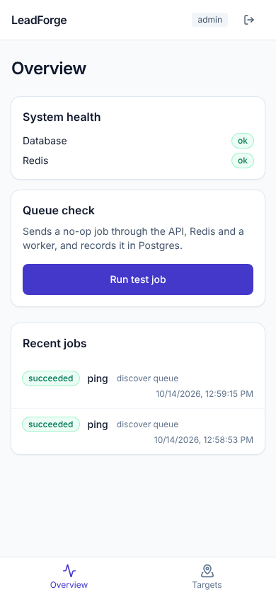
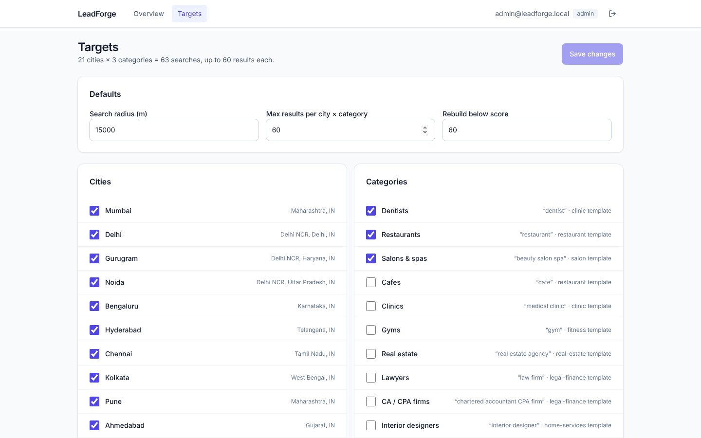

# LeadForge

LeadForge finds local businesses in Tier-1 Indian and US cities through the official
Google Places API, scores their websites, builds better mobile-first replacements for
the weak ones, and drafts a proposal email for a human to approve. Nothing is ever sent
without a person clicking **Approve & send**.

## Status

| Phase | Scope | State |
| --- | --- | --- |
| 1 | Foundation: monorepo, docker-compose, schema, auth, CI | **Done** |
| 2 | Discovery (Places API) + enrichment (crawl, emails, phones, dedup) | Next |
| 3 | Scoring engine | |
| 4 | Dashboard | |
| 5 | Animated template library | |
| 6 | Generator + deploy + quality gate | |
| 7 | Outreach: drafts, approvals, sending, follow-ups | |
| 8 | Hardening: observability, cost tracking, docs | |

### What works after Phase 1

- **API** (`api/`): FastAPI with JWT login, refresh, `admin` / `reviewer` roles, user
  management, rate-limited login, locked-down CORS, JSON logs, optional Sentry,
  `/health` and `/health/ready` (checks Postgres and Redis). OpenAPI docs at
  `/api/docs`.
- **Schema**: all 13 tables from the spec in one Alembic migration, with `place_id` as
  the durable business key, dedup indexes, source tracking on every contact, a
  one-target check on audits, and a global suppression list. See
  [docs/architecture.md](docs/architecture.md).
- **Queues** (`worker/`): ARQ workers for `discover`, `enrich`, `audit`, `generate`,
  `deploy` and `email`, with idempotency keys, exponential-backoff retries and a
  dead-letter state. A "Run test job" button proves the whole path.
- **Targets config**: [`config/targets.yaml`](config/targets.yaml) holds every city,
  category, radius and result cap from the brief, validated on load and editable from
  the dashboard by admins.
- **Dashboard** (`dashboard/`): mobile-first login, overview (health + live job list)
  and targets editor.
- **Dev & CI**: `docker-compose`, `make seed` (no API keys needed), GitHub Actions
  running ruff, mypy, eslint, prettier, migrations, pytest on SQLite and Postgres,
  vitest, the dashboard build, and `pip-audit` / `npm audit`. Dependabot is on.

| Mobile overview | Desktop targets |
| --- | --- |
|  |  |

## Quick start

```bash
make up      # postgres, redis, migrations, api, worker, dashboard
make seed    # dev users + a demo campaign
```

Open http://localhost:5173 and sign in as `admin@leadforge.local` /
`admin-change-me-123`. Running without Docker is covered in
[docs/runbook.md](docs/runbook.md).

## Repository layout

```
api/         FastAPI app, models, migrations (package: leadforge)
worker/      ARQ queue workers (package: leadforge_worker)
dashboard/   React + TypeScript + Vite + Tailwind + TanStack Query
templates/   Generated-site templates (Phase 5)
infra/       Dockerfiles and docker-compose.yml
config/      targets.yaml, agency.yaml
docs/        architecture, runbook, decisions
```

## Configuration

All secrets come from environment variables; see [`.env.example`](.env.example). With
`MOCK_APIS=true` (the default) no external API is called. Agency details and pricing
live in [`config/agency.yaml`](config/agency.yaml) and are placeholders until confirmed;
see [docs/decisions.md](docs/decisions.md).

## Compliance guardrails

- Business data comes only from the official Places API (New), never from scraping Maps.
- Crawls respect robots.txt and crawl-delay, with a clear User-Agent.
- Only publicly published business contacts are stored, each with its source URL.
- Every outreach message is a draft until a human approves it, and the suppression list
  is checked before anything is sent.

## Development

```bash
make check    # lint + typecheck + tests, same as CI
make help     # all targets
```
