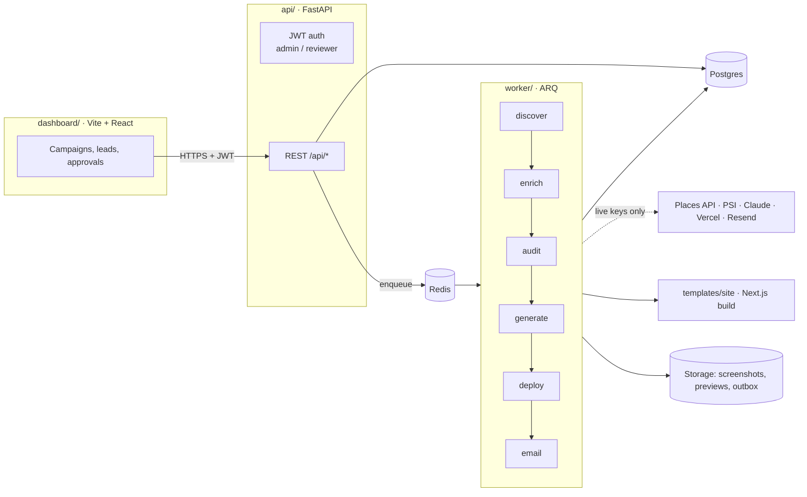

# Architecture

## Packages

| Path | What it is |
| --- | --- |
| `api/leadforge` | FastAPI app, SQLAlchemy 2 models, Alembic migrations, auth, config loading. Also the shared library the worker imports. |
| `api/leadforge/pipeline` | Job handlers (`discover`, `enrich`, `audit`, `generate`, `draft_outreach`, `send_email`, `send_due`, maintenance) and the runner. |
| `api/leadforge/clients` | One client per external service, each with a deterministic mock used when `MOCK_APIS=true` or no key is set. |
| `api/leadforge/scoring` | Page signals and the rubric ([scoring.md](scoring.md)). |
| `worker/leadforge_worker` | ARQ workers, one per queue, plus the cron jobs. |
| `dashboard` | Operator UI. |
| `templates` | The Next.js site template (static export, 8 looks), example specs and `site-spec.schema.json`, the contract between the generator and the template. |
| `infra` | Dockerfiles and `docker-compose.yml`. |
| `config` | `targets.yaml` (cities, categories, limits) and `agency.yaml` (sender details, pricing). |

## Jobs

Every unit of work is a row in `jobs` **and** a message on that queue's Redis list.

- **Idempotency:** `jobs.idempotency_key` is unique. Enqueuing the same key twice returns the existing row; the ARQ job id is the row id, so Redis dedups too. A redelivered message for a finished job is a no-op.
- **Retries:** a failing handler marks the row `failed` and is retried with exponential backoff (10s, 20s, 40s…) until `max_attempts`.
- **Dead letter:** after the last attempt (or for an unknown job kind) the row becomes `dead` and stays visible in the dashboard with its error.

## Services and mocks

`services/container.py` builds one `Services` object per process. Each external
service has a live client and a mock with the same interface; the live one is used only
when `MOCK_APIS=false` and its key is set. Tests and `make demo` use `InlineDispatcher`,
which runs jobs in-process instead of through Redis.

## Data model

14 tables:

| Table | Purpose |
| --- | --- |
| `users` | Dashboard accounts, `admin` or `reviewer`. |
| `campaigns` (+ `campaign_businesses`) | A run over a set of cities × categories. A business found by several campaigns is stored once. |
| `businesses` | One row per Google `place_id` (durable key). Normalized name, phone (E.164) and domain are indexed for fuzzy dedup; `duplicate_of_id` links merges. |
| `contacts` | Emails / phones / WhatsApp / socials, each with `source`, `source_url` and `confidence`. |
| `websites` | Crawl state per site, including robots.txt and parked / Cloudflare / timeout states. |
| `audits`, `screenshots` | Scoring runs against an existing site **or** a generated one (DB-enforced: exactly one). Versioned rubric, breakdown, evidence, top issues, 30-day cache. |
| `generated_sites` | Spec, template, Vercel ids, noindex flag, expiry, scores. |
| `email_drafts`, `email_events` | Outreach drafts (status `drafted → approved → sent → replied → won/lost`), follow-up day, unsubscribe token, delivery events. |
| `suppression_list` | Global do-not-contact by email, domain or phone. |
| `form_submissions` | Messages from contact forms on generated sites (stored, not forwarded, while a site is a preview). |
| `api_usage` | Every billable external call, for quotas and the monthly budget cap. |
